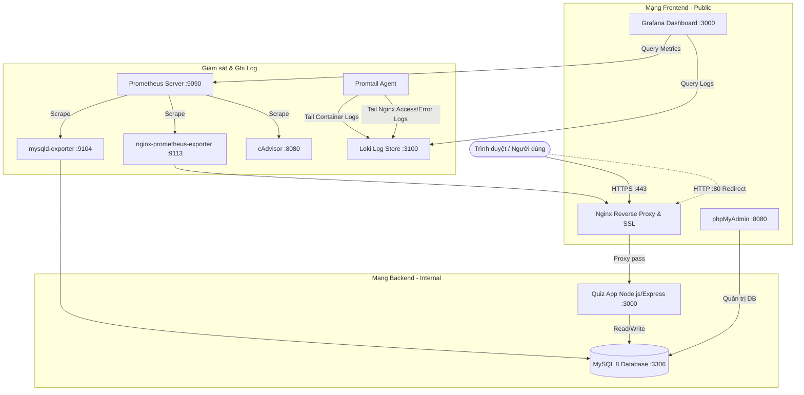

# KẾ HOẠCH TRIỂN KHAI (IMPLEMENTATION PLAN)
## Môn học: Triển khai và Quản trị Hệ thống Phần mềm
### Đề 35: Hệ thống Quiz / Thi trắc nghiệm trực tuyến

---

## 1. Kiến trúc Tổng thể Hệ thống

---

## 2. Kế hoạch Chi tiết 5 Giai đoạn

### Giai đoạn 0: App + MySQL + phpMyAdmin (Khởi tạo hệ thống cơ sở)
- **Mục tiêu**: Xây dựng ứng dụng Quiz đầy đủ tính năng tối thiểu, kết nối MySQL và phpMyAdmin qua Docker Compose.
- **Công việc chi tiết**:
  1. Xây dựng mã nguồn ứng dụng `app/`:
     - Node.js (Express), view engine EJS, CSS giao diện đẹp mắt, dễ sử dụng.
     - Xác thực: Đăng ký, đăng nhập với mã hóa mật khẩu bằng `bcryptjs`, quản lý phiên `express-session`.
     - Phân quyền: 2 vai trò `admin` và `candidate` (thí sinh).
     - Admin: Tạo bài thi, thêm câu hỏi trắc nghiệm (4 lựa chọn A/B/C/D, chọn đáp án đúng).
     - Thí sinh: Xem danh sách đề thi, làm bài, nộp bài, tính điểm tự động và xem lại lịch sử kết quả.
     - Endpoint giám sát sức khỏe: `/health` (kiểm tra trạng thái app và kết nối DB).
     - Request logging: Ghi log chuẩn định dạng ra stdout (method, url, status, duration).
     - `Dockerfile` cho app Node.js (tối ưu, bảo mật non-root).
  2. Tạo script khởi tạo cơ sở dữ liệu `mysql/init.sql`:
     - Bảng `users`, `quizzes`, `questions`, `quiz_results`.
     - Seed sẵn tài khoản mẫu:
       - Admin: `admin@quiz.local` / `Admin@123`
       - Thí sinh: `student@quiz.local` / `Student@123`
     - Seed sẵn 1 đề thi mẫu gồm 5 câu hỏi kiến thức Docker & DevOps.
  3. Cấu hình `docker-compose.yml` (GĐ 0) gồm: `app`, `mysql`, `phpmyadmin`.
  4. Cấu hình file biến môi trường mẫu `.env.example` và file `.env`.
- **Nghiệm thu**:
  - `docker compose up -d --build` chạy thành công.
  - Truy cập App, đăng nhập cả 2 tài khoản, tạo đề thi, làm bài thi và xem kết quả.
  - Truy cập phpMyAdmin kiểm tra dữ liệu bảng `users`, `quizzes`, `questions`, `quiz_results`.
  - Endpoint `/health` trả về `{"status":"UP","database":"CONNECTED"}`.
  - Chụp ảnh minh chứng lưu vào `docs/screenshots/00-app-login.png`, `00-app-admin.png`, `00-app-quiz.png`, `00-phpmyadmin.png`.
- **Commit Git**: `feat: add quiz app with MySQL and phpMyAdmin`

---

### Giai đoạn 1: Nginx Reverse Proxy (HTTPS tự ký + Security Headers)
- **Mục tiêu**: Đóng gói Nginx làm cổng vào duy nhất, kích hoạt HTTPS tự ký, chuyển hướng HTTP sang HTTPS, thiết lập các tiêu chuẩn an toàn web headers và kích hoạt stub_status.
- **Công việc chi tiết**:
  1. Tạo thư mục `nginx/certs/`, sinh SSL/TLS Certificate tự ký (SAN = localhost, 127.0.0.1, thời hạn 365 ngày).
  2. Viết cấu hình `nginx/nginx.conf`:
     - Port 80: Chuyển hướng 301 sang HTTPS (port 443).
     - Port 443: Cấu hình SSL/TLS (TLSv1.2, TLSv1.3, ciphers an toàn).
     - Bảo mật: `server_tokens off;`
     - Security Headers:
       - `X-Frame-Options: SAMEORIGIN`
       - `X-Content-Type-Options: nosniff`
       - `Strict-Transport-Security: max-age=31536000; includeSubDomains`
       - `Content-Security-Policy: default-src 'self' ...`
       - `Referrer-Policy: strict-origin-when-cross-origin`
     - Reverse Proxy chuyển hướng tới container `app:3000`.
     - Location `/stub_status` (bật stub_status để phục vụ Nginx exporter ở giai đoạn sau).
  3. Cập nhật `docker-compose.yml`:
     - Thêm service `nginx`.
     - Ẩn port trực tiếp của `app` (chỉ mở thông qua Nginx).
- **Nghiệm thu**:
  - Truy cập `https://localhost` vào được Quiz App.
  - Kiểm tra `curl -I http://localhost` xác nhận redirect 301 sang https.
  - Kiểm tra `curl -k -I https://localhost` xác nhận đầy đủ các Security Headers và không lộ thông tin phiên bản Nginx.
  - Kiểm tra endpoint `/stub_status`.
  - Chụp ảnh minh chứng lưu vào `docs/screenshots/01-nginx-https.png`, `01-security-headers.png`.
- **Commit Git**: `feat: add nginx reverse proxy with self-signed HTTPS and security headers`

---

### Giai đoạn 2: Prometheus + Grafana (Giám sát chỉ số hệ thống)
- **Mục tiêu**: Triển khai hệ thống giám sát thời gian thực với Prometheus thu thập metric từ máy chủ/container, database và web server, hiển thị qua Grafana Dashboards đã được cấu hình tự động (Provisioning).
- **Công việc chi tiết**:
  1. Cấu hình Exporters trong `docker-compose.yml`:
     - `cAdvisor`: Thu thập metric CPU, RAM, Network, I/O của các container.
     - `mysqld-exporter`: Thu thập metric số truy vấn, kết nối, bộ nhớ đệm của MySQL.
     - `nginx-prometheus-exporter`: Thu thập metric request/connection từ endpoint `/stub_status` của Nginx.
  2. Cấu hình Prometheus:
     - Tạo `prometheus/prometheus.yml` với các job scrape: `cadvisor`, `mysql`, `nginx`, `prometheus`.
  3. Cấu hình Grafana Provisioning:
     - `grafana/provisioning/datasources/datasource.yml`: Tự động nạp Prometheus làm Default Datasource.
     - `grafana/provisioning/dashboards/`: Tự động nạp dashboard giám sát Container (cAdvisor), MySQL và Nginx.
- **Nghiệm thu**:
  - Truy cập giao diện Prometheus `:9090/targets`, tất cả các target đều có trạng thái **UP**.
  - Truy cập Grafana `:3000` (không cần add thủ công datasource hay dashboard), dashboard hiển thị biểu đồ metric sống động.
  - Chụp ảnh minh chứng lưu vào `docs/screenshots/02-prometheus-targets.png`, `02-grafana-dashboard.png`.
- **Commit Git**: `feat: add Prometheus and Grafana monitoring`

---

### Giai đoạn 3: Loki + Promtail (Thu thập & Truy vấn Log tập trung)
- **Mục tiêu**: Thu thập toàn bộ log container và log của Nginx về Loki thông qua Promtail, cho phép truy vấn LogQL trực tiếp trên Grafana Explore.
- **Công việc chi tiết**:
  1. Cấu hình `loki/loki-config.yml` lưu trữ log tối ưu.
  2. Cấu hình `promtail/promtail-config.yml`:
     - Thu thập log từ docker container hoặc log volume của Nginx (`/var/log/nginx/`).
     - Gắn nhãn phân loại (labels: `job`, `container`, `service`).
  3. Tích hợp Loki Datasource vào Grafana (`grafana/provisioning/datasources/loki-datasource.yml`).
  4. Viết tài liệu `docs/logql-queries.md` với ít nhất 3 truy vấn LogQL thực tế:
     - Truy vấn 1: Lọc toàn bộ log truy cập của Nginx.
     - Truy vấn 2: Lọc các request lỗi 404 hoặc 500 từ Nginx & App log.
     - Truy vấn 3: Tính tốc độ request trung bình theo thời gian `rate()` / `count_over_time()`.
- **Nghiệm thu**:
  - Gửi request đến App tạo log.
  - Mở Grafana Explore, chọn Datasource Loki, chạy thành công cả 3 query LogQL, hiển thị kết quả và biểu đồ.
  - Chụp ảnh minh chứng lưu vào `docs/screenshots/03-grafana-explore-loki.png`.
- **Commit Git**: `feat: add Loki and Promtail centralized logging with LogQL`

---

### Giai đoạn 4: Security Hardening & Hoàn thiện README
- **Mục tiêu**: Áp dụng các kỹ thuật Hardening toàn diện bảo vệ hệ thống và viết tài liệu hướng dẫn kỹ thuật chi tiết bằng tiếng Việt.
- **Công việc chi tiết**:
  1. Thực hiện ít nhất 6 biện pháp Hardening chuẩn DevOps:
     - **Non-root user**: Container app chạy dưới quyền user `node` (UID 1000), không dùng root.
     - **Tách biệt mạng (Network Segmentation)**:
       - `frontend-net`: Nginx, Grafana, phpMyAdmin (public).
       - `backend-net` (`internal: true`): MySQL, App, Exporters (không thể bị truy cập từ ngoài internet).
       - Không publish cổng `3306` của MySQL ra máy host.
     - **Quản lý biến môi trường bảo mật**: File `.env` chứa mật khẩu mạnh, commit `.env.example` mẫu, `.gitignore` chặn rò rỉ `.env`.
     - **Least Privilege DB User**: Tạo user ứng dụng `quiz_user` với quyền hạn chế chỉ trên DB `quiz_db`, tách biệt hoàn toàn với `root`.
     - **Giảm thiểu quyền Linux Container**: Thiết lập `cap_drop: [ALL]`, `security_opt: [no-new-privileges:true]`.
     - **Giới hạn tài nguyên (Resource Limits)**: Áp dụng `limits: cpus, memory` trong Compose cho từng container chống DoS/tràn RAM.
     - **Bảo vệ phpMyAdmin**: Chỉ cho phép truy cập nội bộ hoặc qua Nginx xác thực.
  2. Viết tài liệu `README.md` chuẩn chỉnh bằng tiếng Việt:
     - Giới thiệu đề tài & công nghệ.
     - Sơ đồ kiến trúc Mermaid đầy đủ.
     - Hướng dẫn cài đặt & triển khai từ con số 0 (`.env.example` -> `.env` -> `docker compose up`).
     - Bảng tổng hợp cổng dịch vụ, đường dẫn URL, tài khoản đăng nhập mẫu.
     - Hướng dẫn thao tác Grafana (Dashboards) & Loki (LogQL).
     - Bảng tổng hợp các biện pháp Hardening và lý do thiết kế (phục vụ phản biện vấn đáp).
     - Hướng dẫn xử lý sự cố thường gặp (Troubleshooting checklist).
- **Nghiệm thu**:
  - Chạy `docker compose down -v` dọn dẹp sạch sẽ, sau đó chạy `docker compose up -d --build` dựng lại toàn bộ trơn tru từ đầu.
  - Toàn bộ service hoạt động ổn định, dữ liệu seed tự động nạp.
  - Chụp ảnh minh chứng `docs/screenshots/04-hardening-verification.png`.
- **Commit Git**: `feat: apply security hardening and complete README`
