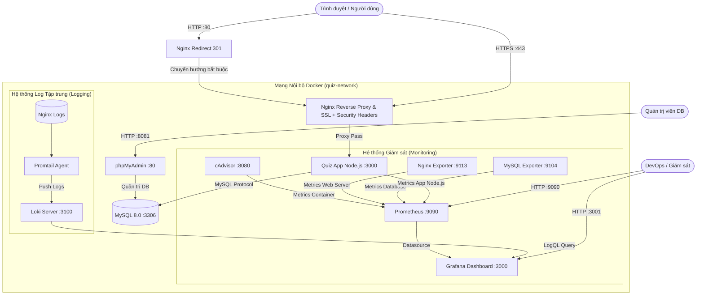

# BÁO CÁO TRIỂN KHAI & HƯỚNG DẪN VẬN HÀNH HỆ THỐNG
## ĐỀ TÀI 35: HỆ THỐNG QUIZ / THI TRẮC NGHIỆM TRỰC TUYẾN
- **Môn học:** Triển khai và Quản trị Hệ thống Phần mềm
- **Giảng viên hướng dẫn:** Thầy Tâm
- **Mã số sinh viên (MSSV):** `DTC245180058`
- **Tài khoản GitHub:** `loantranthi175-netizen`

---

## 📑 MỤC LỤC
1. [Giới thiệu Đề tài & Kiến trúc Hệ thống](#1-giới-thiệu-đề-tài--kiến-trúc-hệ-thống)
2. [Bảng Phân công & Cổng Dịch vụ (Port Mapping)](#2-bảng-phân-công--cổng-dịch-vụ-port-mapping)
3. [Lịch sử Commit Chuẩn theo Tiêu chí Đề bài](#3-lịch-sử-commit-chuẩn-theo-tiêu-chí-đề-bài)
4. [Hướng dẫn Cài đặt & Khởi chạy Hệ thống](#4-hướng-dẫn-cài-đặt--khởi-chạy-hệ-thống)
5. [Thông tin Đăng nhập Mẫu để Thử nghiệm](#5-thông-tin-đăng-nhập-mẫu-để-thử-nghiệm)
6. [Hệ thống Giám sát Metrics (Prometheus + Grafana)](#6-hệ-thống-giám-sát-metrics-prometheus--grafana)
7. [Hệ thống Quản lý Log Tập trung (Loki + Promtail + LogQL)](#7-hệ-thống-quản-lý-log-tập-trung-loki--promtail--logql)
8. [Các Biện pháp Bảo vệ & Hardening Hệ thống](#8-các-biện-pháp-bảo-vệ--hardening-hệ-thống)
9. [Hướng dẫn Đưa Dự án lên GitHub theo MSSV](#9-hướng-dẫn-đưa-dự-án-lên-github-theo-mssv)

---

## 1. Giới thiệu Đề tài & Kiến trúc Hệ thống

Hệ thống cho phép:
- **Quản trị viên (Admin):** Tạo đề thi, quản lý ngân hàng câu hỏi trắc nghiệm (4 đáp án A/B/C/D), theo dõi thống kê kết quả làm bài của thí sinh.
- **Thí sinh (Candidate):** Đăng ký/đăng nhập, xem danh sách bài thi, làm bài trực tuyến với bộ đếm thời gian, chấm điểm tự động và xem lại lịch sử làm bài.

Toàn bộ hệ thống được đóng gói và vận hành hoàn toàn bằng **Docker Compose** với kiến trúc nhiều tầng bảo mật và giám sát:



---

## 2. Bảng Phân công & Cổng Dịch vụ (Port Mapping)

| Dịch vụ | Tên Container | Image | Cổng trên Host | Cổng nội bộ | Vai trò |
| :--- | :--- | :--- | :---: | :---: | :--- |
| **Nginx** | `quiz-nginx` | `nginx:alpine` | **80, 443** | 80, 443 | Cổng vào duy nhất, HTTPS tự ký, 7 Security Headers |
| **Quiz App** | `quiz-app` | `thi_thay_tam-app` | *Đóng* | 3000 | Ứng dụng thi trắc nghiệm (Express + EJS) |
| **MySQL** | `quiz-mysql` | `mysql:8.0` | *Đóng* | 3306 | Cơ sở dữ liệu chính (bảo mật, không mở cổng ra ngoài) |
| **phpMyAdmin** | `quiz-phpmyadmin` | `phpmyadmin:5.2.1` | **8081** | 80 | Quản lý dữ liệu MySQL qua giao diện Web |
| **cAdvisor** | `quiz-cadvisor` | `gcr.io/cadvisor/cadvisor:v0.49.1` | *Đóng* | 8080 | Thu thập metrics CPU, RAM, Network containers |
| **Nginx Exporter**| `quiz-nginx-exporter` | `nginx/nginx-prometheus-exporter:1.1.0` | *Đóng* | 9113 | Cào metrics từ `/stub_status` của Nginx |
| **MySQL Exporter**| `quiz-mysql-exporter` | `prom/mysqld-exporter:v0.15.1` | *Đóng* | 9104 | Cào metrics hiệu năng MySQL Database |
| **Prometheus** | `quiz-prometheus` | `prom/prometheus:v2.51.2` | **9090** | 9090 | Máy chủ thu thập & lưu trữ Time-Series Metrics |
| **Grafana** | `quiz-grafana` | `grafana/grafana:10.4.2` | **3001** | 3000 | Bảng điều khiển trực quan hóa Metrics & Logs |
| **Loki** | `quiz-loki` | `grafana/loki:2.9.8` | **3100** | 3100 | Kho lưu trữ và lập chỉ mục Log tập trung |
| **Promtail** | `quiz-promtail` | `grafana/promtail:2.9.8` | *Đóng* | 9080 | Agent thu thập log Nginx và gửi vào Loki |

---

## 3. Lịch sử Commit Chuẩn theo Tiêu chí Đề bài

Dự án tuân thủ nghiêm ngặt yêu cầu phân chia commit của đề tài môn học:

```bash
* d708514 feat: add Loki and Promtail centralized logging with LogQL queries    (-> commit 3)
* 998cbfc feat: add Prometheus and Grafana monitoring for container, web server and database (-> Commit 2)
* 83e7e5a feat: add nginx reverse proxy with self-signed HTTPS and security headers (-> commit 1)
* 2fc75cb feat: add quiz app with MySQL and phpMyAdmin                         (-> commit 0 / Nền tảng)
```

---

## 4. Hướng dẫn Cài đặt & Khởi chạy Hệ thống

### Yêu cầu tiên quyết:
- Máy tính đã cài đặt **Docker Desktop** (bật WSL2 trên Windows) và **Git**.

### Các bước chạy hệ thống:
```powershell
# 1. Di chuyển vào thư mục dự án
cd e:\Thi_Thay_Tam

# 2. Khởi tạo file biến môi trường (nếu chưa có)
copy .env.example .env

# 3. Khởi động và build toàn bộ hệ thống container
docker compose up -d --build

# 4. Kiểm tra trạng thái hoạt động của các container
docker compose ps
```

---

## 5. Thông tin Đăng nhập Mẫu để Thử nghiệm

### 🎓 Ứng dụng Web Thi Trắc Nghiệm:
- Đường dẫn: [**`https://localhost`**](https://localhost) *(Bấm "Advanced" $\rightarrow$ "Proceed to localhost" để chấp nhận chứng chỉ SSL tự ký)*
- **Tài khoản Quản trị viên (Admin):**
  - Email: `admin@quiz.local`
  - Mật khẩu: `Admin@123`
- **Tài khoản Thí sinh (Sinh viên):**
  - Email: `student@quiz.local`
  - Mật khẩu: `Student@123`

### 🗄️ Quản trị Cơ sở dữ liệu phpMyAdmin:
- Đường dẫn: [**`http://localhost:8081`**](http://localhost:8081)
- Server: `mysql`
- Tài khoản: `quiz_user` (hoặc `root`)
- Mật khẩu: `060606`

### 📈 Bảng điều khiển Grafana (Giám sát Metrics & Logs):
- Đường dẫn: [**`http://localhost:3001`**](http://localhost:3001)
- Tài khoản mặc định: `admin` / `admin`

---

## 6. Hệ thống Giám sát Metrics (Prometheus + Grafana)

1. **Prometheus Targets:** Truy cập [**`http://localhost:9090/targets`**](http://localhost:9090/targets). Cả 5 target đều có trạng thái **UP (Xanh lá)**:
   - `cadvisor-containers` (giám sát container)
   - `nginx-web` (giám sát web server)
   - `quiz-app` (giám sát Node.js)
   - `mysql-database` (giám sát database)
   - `prometheus` (tự giám sát)
2. **Grafana Dashboards:** Truy cập [**`http://localhost:3001`**](http://localhost:3001), mở thư mục **Quiz System Dashboards** đã nạp sẵn 3 dashboard:
   - `01. Giám sát Containers (cAdvisor)`: Tải CPU, RAM, Network Tx/Rx theo từng container.
   - `02. Giám sát Nginx & Web App`: Lưu lượng request/giây, số kết nối đồng thời, lỗi HTTP 5xx.
   - `03. Giám sát Database MySQL`: Tốc độ truy vấn (QPS), số kết nối Threads, Buffer Pool, Slow Queries.

---

## 7. Hệ thống Quản lý Log Tập trung (Loki + Promtail + LogQL)

1. Mở Grafana Explore: [**`http://localhost:3001/explore`**](http://localhost:3001/explore)
2. Chọn Data Source: **Loki**
3. Thực hiện ít nhất 3 truy vấn LogQL:

| Số | Truy vấn LogQL | Mục đích sử dụng |
| :---: | :--- | :--- |
| **1** | `{job="nginx", log_type="access"}` | Xem toàn bộ log truy cập web thời gian thực |
| **2** | `{job="nginx"} \| json \| status >= 400` | Lọc các request bị lỗi (404 Not Found, 500 Error) |
| **3** | `sum(rate({job="nginx"}[1m]))` | Vẽ biểu đồ tần suất request theo từng phút |

*(Chi tiết xem thêm tại [`docs/logql-queries.md`](docs/logql-queries.md)).*

---

## 8. Các Biện pháp Bảo vệ & Hardening Hệ thống

Dự án áp dụng đầy đủ 6 biện pháp bảo mật nâng cao (Tiêu chí 6):
1. **Non-root Container:** Container `app` chạy bằng tài khoản người dùng hạn chế `USER node` (UID 1000) trong Dockerfile, không dùng quyền root.
2. **Ẩn cổng dịch vụ nội bộ (Network Isolation):** Cổng `3000` của Node.js và cổng `3306` của MySQL không mở ra ngoài máy host, chỉ giao tiếp nội bộ trong mạng ảo `quiz-network`.
3. **Phân quyền người dùng DB (Least Privilege):** App kết nối vào DB bằng người dùng riêng `quiz_user`, không sử dụng tài khoản tối cao `root`.
4. **Bộ 7 Security Headers chuẩn OWASP:**
   - `Strict-Transport-Security: max-age=31536000; includeSubDomains` (HSTS)
   - `X-Frame-Options: SAMEORIGIN` (Chống Clickjacking)
   - `X-Content-Type-Options: nosniff` (Chống MIME-sniffing)
   - `X-XSS-Protection: 1; mode=block`
   - `Content-Security-Policy: default-src 'self' ...` (CSP)
   - `Referrer-Policy: strict-origin-when-cross-origin`
   - `Permissions-Policy: geolocation=(), microphone=(), camera=()`
5. **Ẩn thông tin phiên bản máy chủ:** Nginx bật `server_tokens off;` để ngăn chặn hacker thăm dò phiên bản phần mềm.
6. **Mã hóa an toàn & Quản lý biến môi trường:** Mật khẩu người dùng được băm bằng `bcryptjs` (salt 10). Mật khẩu hệ thống được lưu trong `.env` và chặn đưa lên Git qua `.gitignore`.

---

## 9. Hướng dẫn Đưa Dự án lên GitHub theo MSSV

Theo yêu cầu: *Tạo tài khoản hoặc Repository đặt tên theo Mã số Sinh viên (MSSV)*:

```bash
# Giả sử MSSV của bạn là 20110000, tạo repo trên GitHub: https://github.com/your-username/20110000_Thi_Thay_Tam

# 1. Thêm địa chỉ Remote GitHub của bạn
git remote add origin https://github.com/<tai-khoan-github>/<ten-repo-theo-mssv>.git

# 2. Đổi tên nhánh chính sang main (hoặc giữ nguyên master)
git branch -M main

# 3. Đẩy toàn bộ mã nguồn và 3 commit chuẩn lên GitHub
git push -u origin main
```
